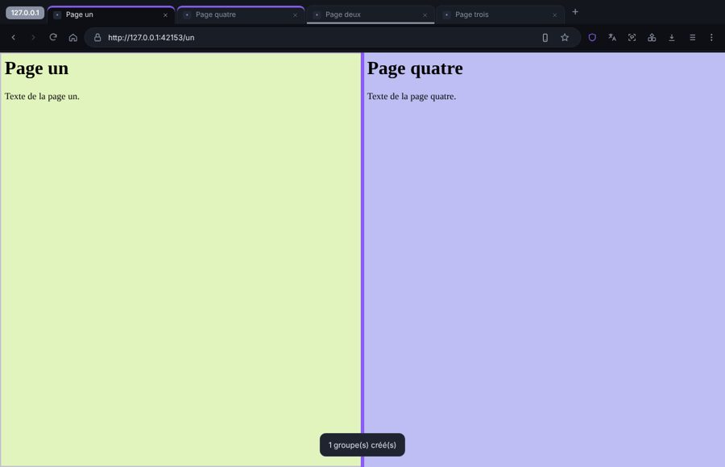
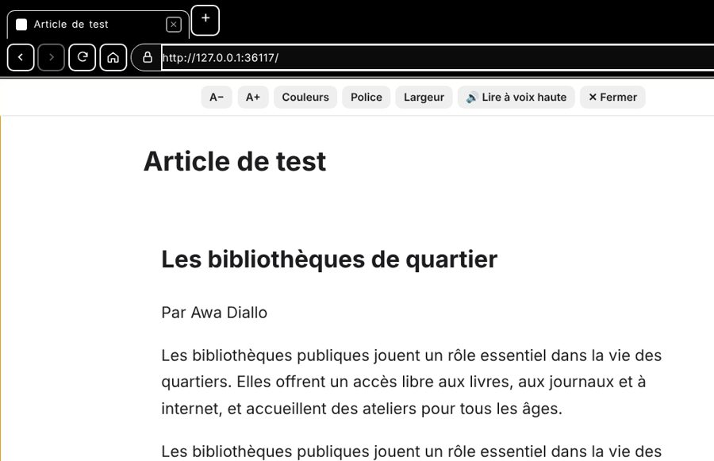
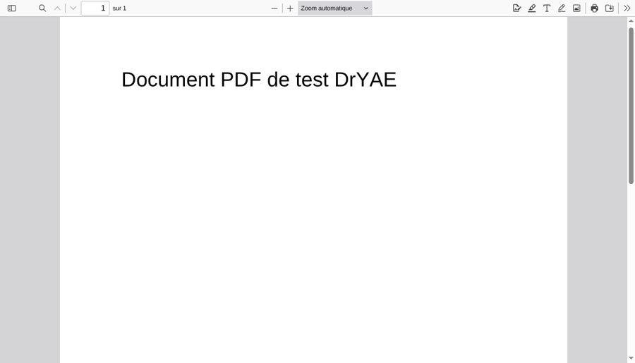
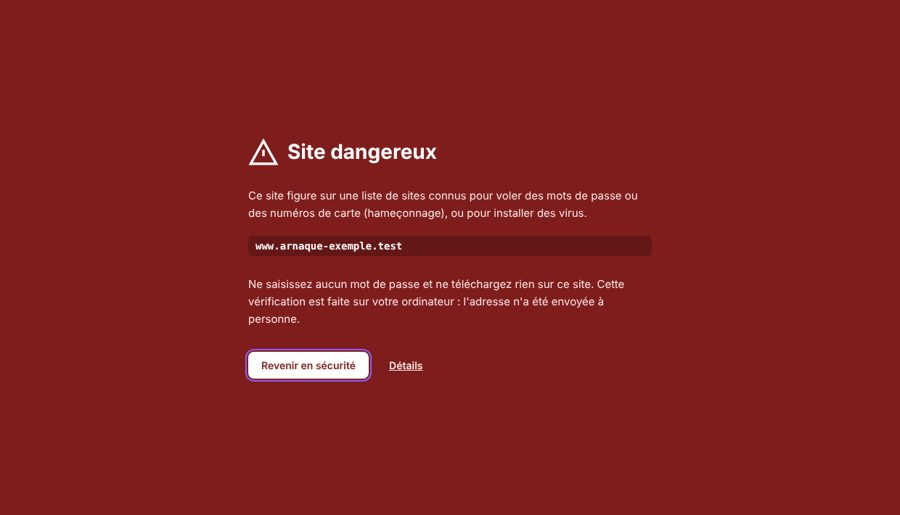
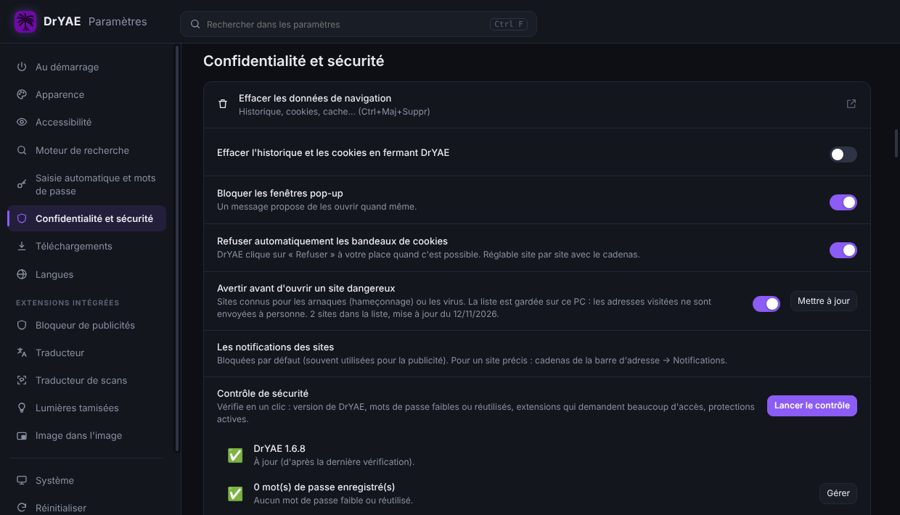

# DrYAE user guide

*[Version française](GUIDE.md)*

## 1. Install
1. Download **DrYAE-Setup-x.y.z.exe** from [Releases](https://github.com/DrYAE-FPA/dryae/releases/latest).
2. Run it and pick your language from the list (English by default).
3. Accept the license and follow the steps. The installer adds a Desktop shortcut and a Start menu entry.

Windows may show "Windows protected your PC" because the app isn't signed by a paid publisher. Click **More info → Run anyway**.

**Portable version:** unzip it and run `DrYAE.exe`. Nothing needs to be installed, but one-click updates aren't available.

## 2. The download manager
The download manager works like a Windows folder:
- **on the left**, filters: All, Downloading, Finished, Paused, Scheduled and Failed, plus types (Torrents, Online videos…) and categories (Videos, Music, Documents…);
- **at the top**, **Add**, **Resume all**, **Pause all** and search (Ctrl+F or F3);
- **the command bar**: New, Copy, Copy path, Rename, Delete, Open, Pause, Resume, Properties, **Sort**, **View**, ⋯ (more commands) and **Details** (details pane);
- **in the middle**, the list, and **at the bottom** the status bar (item count, selection and size).

### Views
**View** offers Large icons, Medium icons, Small icons, List, Details and Content. You can also use **Ctrl+wheel** or **Ctrl+Shift+2…8**. In Details view, click a column header to sort, and drag its edge to resize it.

### Mouse
- **Click** selects. **Ctrl+click** and **Shift+click** select several items.
- **Double-click** opens a finished file (or the properties of a download in progress).
- **Drag on empty space** to draw a selection rectangle.
- **Right-click** an item for open, folder, pause, rename, copy, remove… **Right-click empty space** for view, sort, paste a link, select all and refresh.
- **Drag a finished file** to a folder, the desktop or another app to copy it.

### Deleting
- **Del** or **Shift+Del** opens a small "Remove from the list" window. The box **Also delete the file from the computer** sends the file to the **Windows Recycle Bin** (you can still get it back). It is ticked automatically with Shift+Del; otherwise DrYAE remembers your last choice.
- Without the box, only the item leaves the list: an **Undo** button appears for a few seconds; **Ctrl+Z** does the same.

### Add a download
- **Add → Link:** paste one or more addresses, one per line. You can choose the folder, the file name, the number of connections and a speed limit.
- **Drag and drop:** drop links or `.torrent` files onto the window.
- **Clipboard:** when you copy a link, DrYAE offers to download it. You can turn this off in Settings.
- **Batch:** an address containing `[1-50]` is expanded to 1, 2, 3… up to 50.

### Duplicates
If a file is already in the list or already downloaded (same link or same title), DrYAE always tells you, whether you add it from the manager or from the browser: **Open the file**, **Download anyway**, **Replace** or **Cancel**. If the file was deleted from the computer, DrYAE offers **Download again**. Tick "Always do this" to stop being asked. With several links, a single question groups all duplicates.

### When a download fails
DrYAE explains the problem in plain words (in your language) and offers a button to fix it: **Choose another folder** (disk full, forbidden folder or USB drive removed), **Free up space**, **Find the link on the page** (expired link), **Allow DrYAE in the firewall** (torrents), **Retry**. If the internet is down or the site has a temporary problem, DrYAE **resumes on its own** when the connection is back. Before a big download, DrYAE checks there is enough free space.

### Scan a downloaded program
For an .exe, .msi, .zip, .rar… file: right-click → **Scan with Windows antivirus** (or the button in Details). DrYAE shows Microsoft Defender's result.

### Clearing the list
The **trash** button at the top removes finished downloads from the list (the files stay on disk). It asks first; tick "Don't ask again" to skip the question (turn it back on in Settings → General).

### If a link expired
Right-click → **Refresh link** and paste a new link to the same file. The download resumes where it stopped.

## 3. Videos (MP4 / MP3)
1. Open the **DrYAE browser** with the button on the left or Ctrl+B, then go to the video page.
2. Click the **download icon** at the top right. The small number is the count of videos found.
3. The **Choose a format** panel shows:
   - **Video · MP4**, with the quality (1080p, 720p…) and the size of each file;
   - **MP3 audio** at 320, 192 or 128 kb/s, or M4A without re-encoding;
   - the files detected during playback.
4. Click **Download**. It keeps running in the background while you browse.

**More options** lets you change the name, folder or speed, add the download paused, or schedule it.

If no video is found, start playing it, then try again. If a YouTube video stops downloading, go to **Settings → Downloads → Update yt-dlp**.

DRM-protected videos (Netflix, Disney+…) cannot be downloaded.

## 4. Torrents
- Use **Add → Torrent**, click a `magnet:` / `.torrent` link in the DrYAE browser (the file picker opens on the page, you stay there), or drop a `.torrent` file.
- The torrent engine (aria2) is native and very light: it only runs while torrents are downloading.
- DrYAE reads the file list. Tick the files you want. For a magnet link, a counter shows the peer search ("Searching for peers… 12 s") with a **Cancel** button. If nobody is found after 30 seconds, DrYAE explains how to allow its torrent engine (aria2c) in the Windows firewall.
- If you add a torrent that is already there, DrYAE says so and offers to **add its trackers** to the existing download (often faster).
- **Sequential download** lets you watch a video while it downloads.
- Seeding after the download and the share ratio are set in Settings → Torrents.

## 5. The built-in browser
- **Tabs:** Ctrl+T for a new tab, Ctrl+Shift+N for a private tab, Ctrl+W to close. Drag tabs to reorder them. A tab only loads when you open it.
- **Mouse:**
  - side buttons go to the previous / next page;
  - middle-click or Ctrl+click a link to open it in a background tab;
  - middle-click a tab to close it;
  - double-click the tab bar to open a new tab;
  - Ctrl+wheel zooms.
- **⋮ menu:** new tab, private tab, **Passwords and autofill**, **History** (with recently closed tabs), **Downloads**, **Bookmarks**, **Extensions**, clear browsing data, zoom, print, translate page, find, save as, more tools, help, **Settings**.
- **Management pages:** History (Ctrl+H), Bookmarks (Ctrl+Shift+O), Passwords, Extensions (Ctrl+Shift+X) and Settings open in a tab. They work with the keyboard like the download manager: ↑ ↓ to move, Shift+↑↓ or Ctrl+click to select, Ctrl+A select all, Enter open, Ctrl+Enter new tab, Del delete, F2 edit, Ctrl+Z undo, Ctrl+F search.
- **History:** by date or by site; "Clear browsing data" (Ctrl+Shift+Del) with a time range (15 minutes, 1 hour, 24 hours, 7 days, 4 weeks, all time).
- **Bookmarks:** the star (Ctrl+D) adds the page and lets you choose its name and folder; Ctrl+Shift+D bookmarks all tabs; Ctrl+Shift+B shows the **bookmarks bar** (drag and drop, right-click, folders). The bookmark manager organizes, sorts, imports and exports (HTML file).
- **Detected file(s):** the download button lists everything the page plays, with the size (estimated "~" for streams), the number of pieces, the resolution and the duration.
- **Passwords:** after you sign in, DrYAE offers to save the password; on a sign-up page it suggests a strong password. Passwords are encrypted by Windows on your PC. The Passwords page groups them by site and offers:
  - **Check-up**: breached, reused or weak passwords;
  - **Payment methods** (cards, without the CVC) and **Addresses**, offered in forms;
  - **Settings**: Windows Hello before showing a password, .csv import/export (url, username, password columns), refused sites.
- **At startup**, DrYAE opens the browser. To open the manager instead: manager settings → General → "When DrYAE starts, open".
- **Extensions menu** (3-block button): all extensions, built-in and Chrome. Click an extension to open it, the **pin** to show or hide it in the toolbar, ⋮ for its options. **Drag** a menu row, or a toolbar button, to change the order.
- **Built-in extensions** (turn on/off, pin, remove, options):
  - **Ad blocker**: the shield opens a window with site protection, the **filtering mode** (None, Basic, Optimal), the number of blocked items and "Hide an element";
  - **Downloads with DrYAE**: when off, the browser saves files itself (downloads button in the toolbar);
  - **Translator**: select text and click the button that appears; the translator window picks up the text selected on the page and translates what you type as you type, translates the page (Ctrl+Shift+E) and can translate a site automatically. A **second language** is used when the text is already in the first one. Right-click a link → "Translate link text";
  - **Image text translator**: the image language is detected automatically ("Automatic") and the text is translated into French, or into English if it is already French. Toolbar button for all images, **Ctrl+Shift+S** to translate an area (draw a rectangle, then "Translate area"), or right-click an image. When hovering a translated image, icons let you see the original, **compare** by dragging, read again or copy the text;
  - **Dimmed lights** (Ctrl+Shift+L): opacity (Alt+↑ / Alt+↓), color, eye protection (Alt+F10), glow, video tools (speed, loop, zoom, filters, screenshot, fill tab), night mode per site or everywhere (with a schedule);
  - **Picture-in-picture**: button on videos, or Ctrl+Shift+U.
- **Lists (history, bookmarks, passwords)**: click a row to select it, or hold the click and drag to select several (Ctrl to add).
- **Bookmarks**: in the star bubble, "Choose another folder…" opens a window with the name, address, folders and "New folder".
- **Two-step sign-in** (address, then password): clicking the address field shows your saved accounts for that site.
- **Chrome extensions:** open the Chrome Web Store from the Extensions page, then click "Add to Chrome". If the store does not show, paste the extension's link (or ID) into **Install from a link**.
- If a "Are you human?" check doesn't pass, use **⋮ → Open this page in Chrome** with the DrYAE extension (see section 7).

- **Click in the page:** extension windows and menus close.
- **Bookmarks bar:** drag a bookmark or folder to move it (or right-click → Move left / right).
- **Dimmed lights:** "Lights off" stays on for every page and tab until you turn the lights back on; **eye protection** no longer gets in the way of pages.

## 5a. Tabs, reading and tools (new in 1.6.9)
- **Right-click a tab:** new tab to the right, duplicate, mute, **show side by side**, **add to a group**, group tabs by site, close others…
- **Tab groups:** a name and a colour; click the group name to collapse it.
- **Side-by-side view:** two tabs in the same window; drag the middle bar to set the width (double-click: half and half).

- **Search tabs:** Ctrl+Shift+A (type a few letters, Enter).
- **Tab hover preview:** page image, address and memory used.
- **Side panel** (button on the right of the toolbar): bookmarks, history, offline pages, **notes** attached to each page, translator.
- **Reading mode** (F9): only the article text, without ads, with your choice of size, colours and font. **Read aloud** (F8) uses the Windows voices.

- **PDF reader:** highlight, write, draw, add an image or a **signature**, then **Save** the edited PDF.

- **More tools** (⋮ menu): full-page screenshot, keep a page to read offline, page QR code (to open it on a phone), task manager (Shift+Esc).
- **Copy text from an image:** right-click the image.
- **Search keywords:** type "yt cat" in the address bar to search "cat" on YouTube (set them in Settings → Search engine).
- **New tab page:** **Customize** button (background image, size and choice of shortcuts; drag to move them).
- **Performance** (Settings → Tabs and performance): memory saver (sleeping tabs), energy saver on battery, data saver, vertical tabs.
- **Profiles** (⋮ menu → Profiles): each profile has its own bookmarks, passwords, cookies, history and downloads, in its own window.
- **Image text translator:** bubbles are found one by one (the translated text takes the bubble's colour), translated together in reading order, and an image already translated shows at once. **Right-click a bubble** to fix the text or the translation, or add a word to the **glossary** (character names…). For Korean, Russian, Arabic, Thai or Hindi, download the **reading model** once from the image text translator window.
- **Image text translator, reworked:** it turns on **only when you click** its button. The original text is erased inside the bubble and the translation is written in its place, in a comic font, never bigger than the original and without breaking words. In English, misread letters and words split at the end of a line are fixed before translating; "SFX" notes are not translated. **AI translation (optional)**: in the image text translator window, paste your free Google Gemini key ("Get a free key" button, no payment). The AI sees the page and understands the conversation; the image is then sent to Google. When the free daily limit is reached, the usual translation takes over.

## 5b. Accessibility
Settings → **Accessibility**: DrYAE text size (up to 200%), **high contrast** (or as Windows), **easy reading** (simple font and wider letter spacing, helpful for dyslexia), **reduce animations**, **simple mode** (only the essential buttons). Everything also works from the keyboard: Tab, arrows, Esc, F6 (address bar → buttons → page), Alt+F (menu). DrYAE works with screen readers (NVDA, Narrator). Your own shortcuts: Settings → **Keyboard shortcuts**.

## 5c. Privacy and security
- **No ads, no account, no data collection.** Settings → Privacy and security → **What DrYAE sends to the internet** lists everything that goes out, with a switch for each one.
- **Dangerous sites:** DrYAE warns you before opening a site known for scams or viruses. The list is kept on your PC: the addresses you visit are sent to no one.

- **Address bar padlock:** camera, microphone, location, notifications (blocked by default), clipboard, pop-ups, cookie refusal, clear site data.
- **Cookie banners:** DrYAE clicks "Reject" for you when possible.
- **Safety check** in one click: version, weak or reused passwords, extensions with wide access, active protections.

- **Export / import all my data** (Settings → System): a single file, protected by a password if you include your passwords. **Import from another browser**: bookmarks and history from Chrome, Edge, Brave, Opera, Vivaldi or Firefox.

## 6. Scheduler and limits
- **Scheduler:** set a start time, an end time and the days. DrYAE can also shut down the PC at the end.
- **Speed limit:** use the meter at the bottom left, or Settings → Speed & network. There is also a daily quota in MB.
- **Auto shutdown:** DrYAE can turn off the PC when all downloads are finished. You get 60 seconds to cancel.

## 7. Chrome extension (optional)
It sends Google Chrome downloads, videos and magnet links to DrYAE.
1. Go to Settings → **Chrome extension → Open the extension folder**.
2. In Chrome, open `chrome://extensions` and turn on **Developer mode**.
3. Click **Load unpacked** and choose the **Extension Chrome DrYAE** folder.
4. Pin the DrYAE icon. DrYAE must be open to receive downloads.

## 8. Useful settings
- **General:** language, download folder, start with Windows, keep DrYAE in the system tray. When DrYAE starts with Windows, it stays hidden in the taskbar icons; click its icon to open the browser.
- **Downloads:** connections per file (up to 32), simultaneous downloads, what to do if the file already exists, default MP4/MP3 quality.
- **Appearance:** light, dark or black (AMOLED) theme, and accent color (Windows' own color by default).
- **About:** version, **Check for updates**, **Give feedback**, licenses.

## 9. Updates, feedback and problems
- When a new version is out, an **Update** banner appears. Click it: the download shows in the manager. Then click **Restart and install**: DrYAE installs without any window and reopens with your settings and language.
- **Give feedback** opens the [Issues](https://github.com/DrYAE-FPA/dryae/issues) page to suggest an idea.
- **Report a problem…** (⋮ menu → Help, or manager settings → About) creates a small report on your Desktop (versions, Windows, latest errors — no passwords, no history, no full addresses) and opens the issue page. Attach the file to your message.

## 10. Keyboard shortcuts
Press **F1** to open this guide inside DrYAE; the full list of shortcuts is at the top of the guide. You can choose your own shortcuts: Settings → Keyboard shortcuts.

**Download manager (Windows shortcuts):** Ctrl+A (select all) · Ctrl+click / Shift+click · arrows and Shift+arrows · Home / End · Enter (open) · Space (pause/resume) · F2 (rename) · Del (remove from list) · Shift+Del (delete permanently) · Ctrl+Z (undo remove) · Ctrl+C (copy the file) · Ctrl+Shift+C (copy path) · Ctrl+V (paste a link) · Alt+Enter (properties) · Alt+Shift+P (details pane) · Ctrl+Shift+2…8 (views) · F3 / Ctrl+F (search) · F5 (refresh) · Ctrl+E (folder) · Ctrl+N (add link) · Ctrl+T (torrent) · Ctrl+O (.torrent file) · Ctrl+B (browser) · Esc.

**Browser (standard shortcuts):** Ctrl+T · Ctrl+Shift+P (private tab) · Ctrl+W · Ctrl+Shift+T (reopen closed tab) · Ctrl+Tab · Ctrl+1…9 · Ctrl+L / F6 · Ctrl+F / F3 · F5 / Ctrl+R · Alt+←/→ · Ctrl+D · Ctrl+H · Ctrl+J (download manager) · Ctrl+Shift+Y (detected files) · Ctrl+P · Ctrl+S · Ctrl+U · Ctrl+M (mute) · Ctrl+ +/−/0 · F11 · F12 · Ctrl+Shift+Del · Ctrl+Shift+Q.

## Responsible use
Only download content you have the right to copy: your own files, free content, or content you are allowed to download. Follow the terms of service of the sites you visit.
