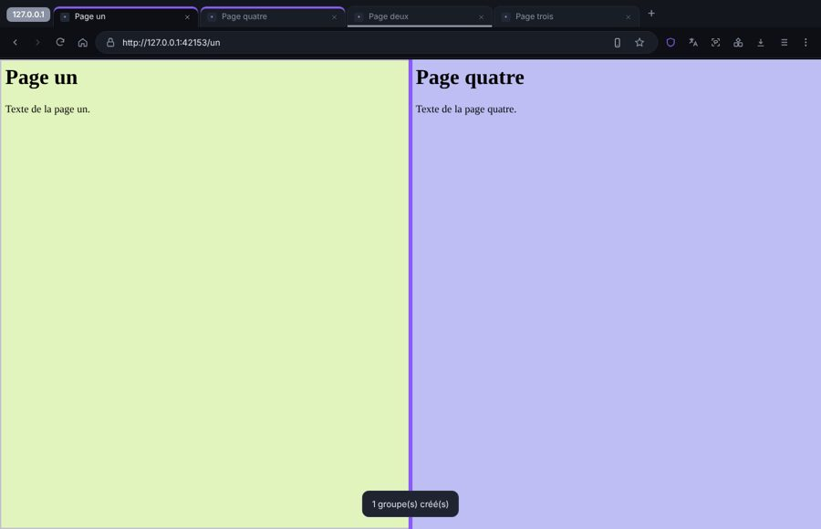
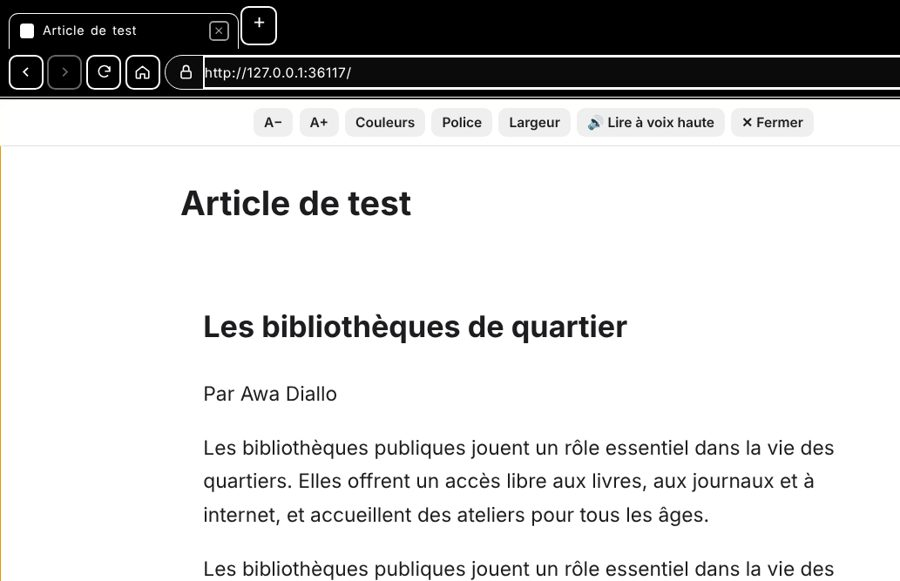
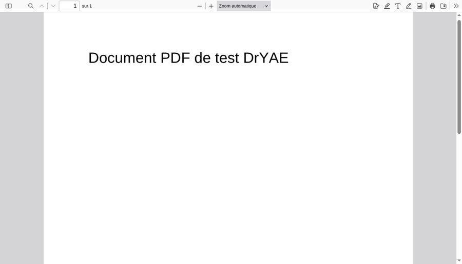
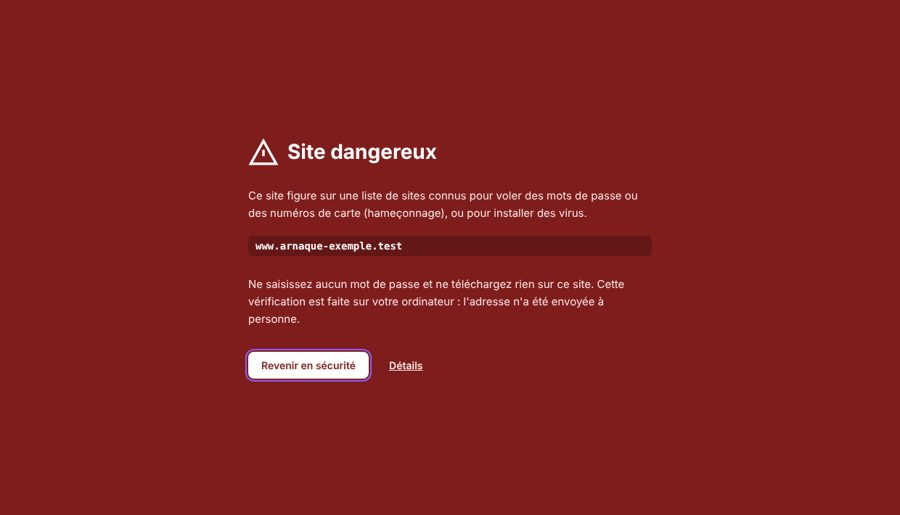
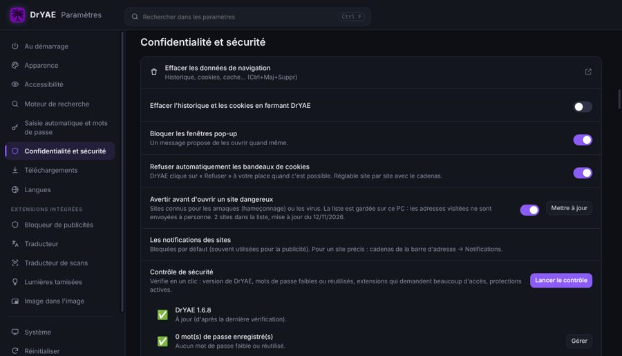

# Guide d'utilisation de DrYAE

*[English version](GUIDE.en.md)*

## 1. Installer
1. Téléchargez **DrYAE-Setup-x.y.z.exe** dans la page [Releases](https://github.com/DrYAE-FPA/dryae/releases/latest).
2. Lancez-le et choisissez votre langue dans la liste (anglais par défaut).
3. Acceptez la licence et suivez les étapes. L'installateur crée un raccourci sur le Bureau et dans le menu Démarrer.

Windows peut afficher « Windows a protégé votre ordinateur », parce que l'application n'est pas signée par un éditeur payant. Cliquez sur **Informations complémentaires → Exécuter quand même**.

**Version portable :** décompressez le zip et lancez `DrYAE.exe`. Il n'y a rien à installer, mais les mises à jour en un clic ne sont pas disponibles.

## 2. Le gestionnaire de téléchargements
Le gestionnaire s'utilise comme un dossier de Windows :
- **à gauche**, les filtres : Tous, En cours, Terminés, En pause, Planifiés, Échecs, ainsi que les types (Torrents, Vidéos en ligne…) et les catégories (Vidéos, Musique, Documents…) ;
- **en haut**, le bouton **Ajouter**, **Tout reprendre**, **Tout mettre en pause** et la recherche (Ctrl+F ou F3) ;
- **la barre de commandes** : Nouveau, Copier, Copier le chemin, Renommer, Supprimer, Ouvrir, Pause, Reprendre, Propriétés, **Trier**, **Affichage**, ⋯ (plus de commandes) et **Détails** (volet des détails) ;
- **au centre**, la liste, et **en bas** la barre d'état (nombre d'éléments, sélection et taille).

### Affichages
**Affichage** propose : Grandes icônes, Icônes moyennes, Petites icônes, Liste, Détails et Contenu. Vous pouvez aussi utiliser **Ctrl+molette** ou **Ctrl+Maj+2…8**. En affichage Détails, cliquez sur un en-tête de colonne pour trier, et faites glisser son bord pour changer sa largeur.

### Souris
- **Clic** : sélectionne. **Ctrl+clic** et **Maj+clic** : sélection multiple.
- **Double-clic** : ouvre le fichier terminé (ou les propriétés d'un téléchargement en cours).
- **Glisser dans le vide** : sélection au rectangle.
- **Clic droit** sur un élément : ouvrir, dossier, pause, renommer, copier, retirer… ; **clic droit dans le vide** : affichage, tri, coller un lien, tout sélectionner, actualiser.
- **Glisser un fichier terminé** vers un dossier, le Bureau ou une autre application pour le copier.

### Supprimer
- **Suppr** ou **Maj+Suppr** ouvre une petite fenêtre « Retirer de la liste ». La case **Supprimer aussi le fichier de l'ordinateur** envoie le fichier dans la **Corbeille de Windows** (vous pouvez encore le récupérer). Elle est cochée d'office avec Maj+Suppr ; sinon, DrYAE se souvient de votre dernier choix.
- Sans la case, seul l'élément quitte la liste : un bouton **Annuler** apparaît quelques secondes ; **Ctrl+Z** fait la même chose.

### Ajouter un téléchargement
- **Ajouter → Lien :** collez une ou plusieurs adresses (une par ligne). Vous pouvez choisir le dossier, le nom, le nombre de connexions et une limite de vitesse.
- **Glisser-déposer :** déposez des liens ou des fichiers `.torrent` sur la fenêtre.
- **Presse-papiers :** quand vous copiez un lien, DrYAE propose de le télécharger. Vous pouvez désactiver cela dans Paramètres.
- **Lot :** une adresse contenant `[1-50]` est remplacée par 1, 2, 3… jusqu'à 50.

### Doublons
Si un fichier est déjà dans la liste ou déjà téléchargé (même lien ou même titre), DrYAE le dit toujours, que vous l'ajoutiez depuis le gestionnaire ou depuis le navigateur : **Ouvrir le fichier**, **Télécharger quand même**, **Remplacer** ou **Annuler**. Si le fichier a été effacé de l'ordinateur, DrYAE propose **Télécharger à nouveau**. Cochez « Toujours faire ce choix » pour ne plus être interrogé. Avec plusieurs liens, une seule question regroupe tous les doublons.

### Quand un téléchargement échoue
DrYAE explique le problème en clair (dans votre langue) et propose un bouton pour le réparer : **Choisir un autre dossier** (disque plein, dossier interdit ou clé USB retirée), **Libérer de la place**, **Retrouver le lien sur la page** (lien expiré), **Autoriser DrYAE dans le pare-feu** (torrents), **Réessayer**. Si internet est coupé ou si le site a un souci passager, DrYAE **reprend tout seul** quand la connexion revient (l'attente entre deux essais grandit peu à peu). Avant un gros téléchargement, DrYAE vérifie qu'il reste assez de place sur le disque.

### Analyser un programme téléchargé
Pour un fichier .exe, .msi, .zip, .rar… : clic droit → **Analyser avec l'antivirus de Windows** (ou le bouton dans les Détails). DrYAE affiche le résultat de Microsoft Defender.

### Vider la liste
La **corbeille** en haut retire les téléchargements terminés de la liste (les fichiers restent sur le disque). Une confirmation s'affiche ; cochez « Ne plus prévenir » pour la supprimer (réactivable dans Paramètres → Général).

### Si un lien a expiré
Faites un clic droit → **Rafraîchir le lien** et collez un nouveau lien vers le même fichier. Le téléchargement reprend là où il s'était arrêté.

## 3. Vidéos (MP4 / MP3)
1. Ouvrez le **navigateur DrYAE** avec le bouton à gauche ou Ctrl+B, puis allez sur la page de la vidéo.
2. Cliquez sur l'**icône de téléchargement** en haut à droite. Le petit chiffre indique le nombre de vidéos trouvées.
3. Le panneau **Choisir un format** affiche :
   - **Vidéo · MP4**, avec la qualité (1080p, 720p…) et la taille de chaque fichier ;
   - **Audio MP3**, en 320, 192 ou 128 kb/s, ou M4A sans réencodage ;
   - les fichiers détectés pendant la lecture.
4. Cliquez sur **Télécharger**. Le téléchargement continue en arrière-plan, et vous pouvez continuer à naviguer.

**Plus d'options** permet de changer le nom, le dossier ou la vitesse, d'ajouter en pause ou de planifier.

Si aucune vidéo n'est trouvée, lancez la lecture puis réessayez. Si une vidéo YouTube ne se télécharge plus, allez dans **Paramètres → Téléchargements → Mettre à jour yt-dlp**.

Les vidéos protégées par DRM (Netflix, Disney+…) ne peuvent pas être téléchargées.

## 4. Torrents
- **Ajouter → Torrent**, ou cliquez sur un lien `magnet:` / `.torrent` dans le navigateur DrYAE (le choix des fichiers s'ouvre sur la page, sans la quitter), ou déposez un fichier `.torrent`.
- Le moteur torrent (aria2) est natif et très léger : il ne tourne que pendant les téléchargements de torrents.
- DrYAE lit la liste des fichiers. Cochez ceux que vous voulez. Pour un lien magnet, un compteur indique la recherche des pairs (« Recherche de pairs… 12 s ») avec un bouton **Annuler**. Si personne n'est trouvé après 30 secondes, DrYAE explique comment autoriser son moteur de torrents (aria2c) dans le pare-feu de Windows.
- Si vous ajoutez un torrent déjà présent, DrYAE le signale et propose d'**ajouter ses trackers** au téléchargement existant (souvent plus rapide).
- **Téléchargement séquentiel** : permet de regarder une vidéo pendant qu'elle se télécharge.
- Le **partage** (seeding) après la fin et le ratio se règlent dans Paramètres → Torrents.

## 5. Le navigateur intégré
- **Onglets :** Ctrl+T pour un nouvel onglet, Ctrl+Maj+N pour un onglet privé, Ctrl+W pour fermer. Faites glisser les onglets pour les réorganiser. Un onglet ne se charge que lorsque vous l'ouvrez.
- **Souris :** boutons latéraux pour page précédente / suivante ; clic du milieu ou Ctrl+clic sur un lien pour l'ouvrir dans un onglet en arrière-plan ; clic du milieu sur un onglet pour le fermer ; double-clic dans la barre d'onglets pour en ouvrir un ; Ctrl+molette pour le zoom.
- **Menu ⋮ :** nouvel onglet, onglet privé, **Mots de passe et saisie automatique**, **Historique** (avec les onglets fermés récemment), **Téléchargements**, **Favoris**, **Extensions**, effacer les données de navigation, zoom, imprimer, traduire la page, rechercher, enregistrer sous, outils supplémentaires, aide, **Paramètres**.
- **Pages de gestion :** Historique (Ctrl+H), Favoris (Ctrl+Maj+O), Mots de passe, Extensions (Ctrl+Maj+X) et Paramètres s'ouvrent dans un onglet. Elles se pilotent au clavier comme le gestionnaire : ↑ ↓ pour se déplacer, Maj+↑↓ ou Ctrl+clic pour sélectionner, Ctrl+A tout sélectionner, Entrée ouvrir, Ctrl+Entrée nouvel onglet, Suppr supprimer, F2 modifier, Ctrl+Z annuler, Ctrl+F rechercher.
- **Historique :** par date ou par site ; « Effacer les données de navigation » (Ctrl+Maj+Suppr) avec la période (15 minutes, 1 heure, 24 heures, 7 jours, 4 semaines, depuis le début).
- **Favoris :** l'étoile (Ctrl+D) ajoute la page et permet de choisir son nom et son dossier ; Ctrl+Maj+D ajoute tous les onglets ; Ctrl+Maj+B affiche la **barre de favoris** (glisser-déposer, clic droit, dossiers). Le gestionnaire de favoris range, trie, importe et exporte (fichier HTML).
- **Fichier(s) détecté(s) :** le bouton de téléchargement liste tout ce que la page lit, avec la taille (estimée « ~ » pour les flux), le nombre de morceaux, la résolution et la durée. **Tout effacer** vide la liste, **Réinitialiser** la réaffiche, **Trier** change l'ordre, et « Sélectionner les fichiers » permet d'en télécharger plusieurs d'un coup.
- **Mots de passe :** après une connexion, DrYAE propose de l'enregistrer ; sur une page d'inscription, il propose un mot de passe fort. Les mots de passe sont chiffrés par Windows sur votre PC. La page Mots de passe les range par site et propose :
  - **Vérification** : mots de passe compromis (fuites connues), réutilisés ou faibles ;
  - **Modes de paiement** (cartes, sans le code CVC) et **Adresses**, proposés dans les formulaires ;
  - **Paramètres** : Windows Hello avant d'afficher un mot de passe, import / export .csv (colonnes url, username, password), sites refusés.
- **Au démarrage**, DrYAE ouvre le navigateur. Pour ouvrir plutôt le gestionnaire : Paramètres du gestionnaire → Général → « Au démarrage de DrYAE, ouvrir ».
- **Menu des extensions** (bouton à 3 blocs) : toutes les extensions, intégrées et Chrome. Cliquez sur une extension pour l'ouvrir, sur la **punaise** pour l'épingler dans la barre d'outils (ou l'en retirer), sur ⋮ pour ses options. **Glissez** une ligne du menu, ou un bouton de la barre d'outils, pour changer l'ordre.
- **Extensions intégrées** (activer, épingler, retirer, options) :
  - **Bloqueur de publicités** : le bouclier ouvre une fenêtre avec la protection du site, le **mode de filtrage** (Aucun, Basique, Optimal), le nombre d'éléments bloqués et « Masquer un élément » ;
  - **Téléchargements par DrYAE** : désactivée, le navigateur enregistre lui-même les fichiers (bouton de téléchargements dans la barre d'outils) ;
  - **Traducteur** : sélectionnez un texte puis cliquez sur le bouton qui apparaît ; la fenêtre du traducteur reprend le texte sélectionné dans la page et traduit en direct ce que vous tapez, traduit la page (Ctrl+Maj+E) et peut traduire un site automatiquement. Une **deuxième langue** sert quand le texte est déjà dans la première. Clic droit sur un lien → « Traduire le texte du lien » ;
  - **Traducteur de scans** : la langue des images est reconnue toute seule (« Automatique ») et le texte est traduit en français, ou en anglais s'il est déjà en français. Bouton de la barre d'outils pour toutes les images, **Ctrl+Maj+S** pour traduire une zone (dessinez un rectangle puis « Traduire la zone »), ou clic droit sur une image. Au survol d'une image traduite, des icônes permettent de revoir l'original, de **comparer** en glissant, de relire ou de copier le texte ;
  - **Lumières tamisées** (Ctrl+Maj+L) : opacité (Alt+↑ / Alt+↓), couleur, protection des yeux (Alt+F10), lueur, outils vidéo (vitesse, boucle, zoom, filtres, capture, plein onglet), mode nuit par site ou partout (avec horaire) ;
  - **Image dans l'image** : bouton sur les vidéos, ou Ctrl+Maj+U.
- **Listes (historique, favoris, mots de passe)** : cliquez sur une ligne pour la sélectionner, ou maintenez le clic et glissez pour en sélectionner plusieurs (Ctrl pour ajouter).
- **Favoris** : dans la bulle de l'étoile, « Choisir un autre dossier… » ouvre une fenêtre avec le nom, l'adresse, les dossiers et « Nouveau dossier ».
- **Connexion en deux étapes** (adresse puis mot de passe) : un clic dans le champ de l'adresse affiche vos comptes enregistrés pour ce site.
- **Extensions Chrome :** ouvrez le Chrome Web Store depuis la page Extensions, puis cliquez sur « Ajouter à Chrome ». Si la boutique ne s'affiche pas, copiez le lien de la page de l'extension (ou son identifiant) dans **Installer avec un lien**.
- Si une vérification « Êtes-vous un humain ? » ne passe pas, utilisez **⋮ → Ouvrir cette page dans Chrome** avec l'extension DrYAE (voir section 7).

- **Clic dans la page :** les fenêtres des extensions et les menus se ferment.
- **Barre de favoris :** faites glisser un favori ou un dossier pour le déplacer (ou clic droit → Déplacer vers la gauche / la droite).
- **Lumières tamisées :** « Lumières éteintes » reste actif sur toutes les pages et tous les onglets jusqu'à ce que vous rallumiez ; la **protection des yeux** s'applique sans gêner l'affichage des pages.

## 5 bis. Onglets, lecture et outils (nouveautés 1.6.9)
- **Clic droit sur un onglet :** nouvel onglet à droite, dupliquer, couper le son, **afficher côte à côte**, **ajouter à un groupe**, regrouper les onglets par site, fermer les autres…
- **Groupes d'onglets :** un nom et une couleur ; un clic sur le nom du groupe le replie.
- **Vue côte à côte :** deux onglets dans la même fenêtre ; faites glisser la barre du milieu pour régler la largeur (double-clic : moitié-moitié).

- **Rechercher dans les onglets :** Ctrl+Maj+A (tapez quelques lettres, Entrée).
- **Aperçu au survol d'un onglet :** image de la page, adresse et mémoire utilisée.
- **Panneau latéral** (bouton à droite de la barre d'outils) : favoris, historique, pages hors ligne, **notes** liées à chaque page, traducteur.
- **Mode lecture** (F9) : seulement le texte de l'article, sans publicités, avec la taille, les couleurs et la police au choix. **Lire à voix haute** (F8) utilise les voix de Windows.

- **Lecteur PDF :** surligner, écrire, dessiner, ajouter une image ou une **signature**, puis **Enregistrer** le PDF modifié.

- **Outils supplémentaires** (menu ⋮) : capture de la page entière, garder une page pour la lire hors ligne, code QR de la page (pour l'ouvrir sur un téléphone), gestionnaire des tâches (Maj+Échap).
- **Copier le texte d'une image :** clic droit sur l'image.
- **Mots-clés de recherche :** tapez « yt chat » dans la barre d'adresse pour chercher « chat » sur YouTube (à régler dans Paramètres → Moteur de recherche).
- **Page Nouvel onglet :** bouton **Personnaliser** (image de fond, taille et choix des raccourcis ; glisser pour les déplacer).
- **Performances** (Paramètres → Onglets et performances) : économiseur de mémoire (onglets en veille), économiseur d'énergie sur batterie, économiseur de données, onglets verticaux.
- **Profils** (menu ⋮ → Profils) : chaque profil a ses favoris, mots de passe, cookies, historique et téléchargements, dans sa propre fenêtre.
- **Traducteur de scans :** les bulles sont repérées une à une (le texte traduit prend la couleur de la bulle), traduites ensemble dans l'ordre de lecture, et une image déjà traduite s'affiche tout de suite. **Clic droit sur une bulle** pour corriger le texte ou la traduction, ou ajouter un mot au **lexique** (noms des personnages…). Pour le coréen, le russe, l'arabe, le thaï ou le hindi, téléchargez une fois le **modèle de lecture** dans la fenêtre du traducteur de scans.
- **Traducteur de scans, version refaite :** il ne s'allume **que quand vous cliquez** sur son bouton. Le texte d'origine est effacé dans la bulle et la traduction écrite à sa place, avec une police de bande dessinée, jamais plus grande que l'original et sans couper les mots. En anglais, les lettres mal lues et les mots coupés en fin de ligne sont corrigés avant la traduction ; les notes « SFX » ne sont pas traduites. **Traduction IA (facultative)** : dans la fenêtre du traducteur de scans, collez votre clé gratuite Google Gemini (bouton « Obtenir une clé gratuite », aucun paiement). L'IA voit la page et comprend la conversation ; l'image est alors envoyée à Google. Quand la limite gratuite du jour est atteinte, la traduction habituelle prend le relais.
- **Traducteur de scans, petits caractères :** quand un site protège ses images, DrYAE redessine la zone plus grande avant de la lire. Les bulles noires (texte blanc) sont reconnues. Les notes « SFX », les lettres japonaises dessinées et les cris (AHHH, HEHE…) ne sont pas traduits. Par défaut, l'IA (si vous l'avez activée) ne reçoit que les pages difficiles. **Clic droit sur une bulle → « Garder cette image pour l'améliorer »** : l'image est enregistrée dans Documents\DrYAE\Images à améliorer, rien n'est envoyé.
- **Traducteur de scans, BD en français :** les bulles de couleur unie sont reconnues, la lecture du français est corrigée (lettres confondues, mots collés) et les bruitages dessinés restent intacts.
- **Vue côte à côte :** le bouton ⋮ sur la barre de séparation (ou un clic droit sur la barre) permet d'inverser les côtés, de choisir la largeur, de faire défiler les deux côtés ensemble, de séparer les onglets ou de fermer un côté.

## 5 ter. Accessibilité
Paramètres → **Accessibilité** : taille du texte de DrYAE (jusqu'à 200 %), **contraste élevé** (ou comme Windows), **lecture facilitée** (police simple et lettres plus espacées, utile pour la dyslexie), **réduire les animations**, **mode simple** (seulement les boutons essentiels). Tout se fait aussi au clavier : Tab, flèches, Échap, F6 (barre d'adresse → boutons → page), Alt+F (menu). DrYAE fonctionne avec les lecteurs d'écran (NVDA, Narrateur). Vos propres raccourcis : Paramètres → **Raccourcis clavier**.

## 5 quater. Vie privée et sécurité
- **Aucune publicité, aucun compte, aucune collecte.** Paramètres → Confidentialité et sécurité → **Ce que DrYAE envoie sur internet** liste tout ce qui sort, avec un interrupteur pour chaque chose.
- **Sites dangereux :** DrYAE vous avertit avant d'ouvrir un site connu pour les arnaques ou les virus. La liste est gardée sur votre PC : les adresses visitées ne sont envoyées à personne.

- **Cadenas de la barre d'adresse :** caméra, micro, position, notifications (bloquées par défaut), presse-papiers, fenêtres pop-up, refus des cookies, effacer les données du site.
- **Bandeaux de cookies :** DrYAE clique sur « Refuser » à votre place quand c'est possible.
- **Contrôle de sécurité** en un clic : version, mots de passe faibles ou réutilisés, extensions aux accès étendus, protections actives.

- **Exporter / importer toutes mes données** (Paramètres → Système) : un seul fichier, protégé par un mot de passe si vous y mettez vos mots de passe. **Importer depuis un autre navigateur** : favoris et historique de Chrome, Edge, Brave, Opera, Vivaldi ou Firefox.

## 6. Planificateur et limites
- **Planificateur :** choisissez une heure de début et une heure de fin, ainsi que les jours. Vous pouvez aussi éteindre le PC à la fin.
- **Limite de vitesse :** le compteur en bas à gauche, ou Paramètres → Vitesse & réseau. Il existe aussi un quota quotidien en Mo.
- **Arrêt automatique :** DrYAE peut éteindre le PC quand tous les téléchargements sont terminés. Vous avez 60 secondes pour annuler.

## 7. Extension Chrome (facultatif)
Elle envoie à DrYAE les téléchargements de Google Chrome, les vidéos et les liens magnet.
1. Paramètres → **Extension Chrome → Ouvrir le dossier de l'extension**.
2. Dans Chrome, ouvrez `chrome://extensions` et activez le **Mode développeur**.
3. Cliquez sur **Charger l'extension non empaquetée** et choisissez le dossier **Extension Chrome DrYAE**.
4. Épinglez l'icône DrYAE. DrYAE doit être ouvert pour recevoir les téléchargements.

## 8. Paramètres utiles
- **Général :** langue, dossier de téléchargement, démarrage avec Windows (DrYAE reste alors caché dans les icônes de la barre des tâches ; un clic sur son icône ouvre le navigateur), garder DrYAE dans la zone de notification.
- **Téléchargements :** connexions par fichier (jusqu'à 32), téléchargements simultanés, que faire si le fichier existe déjà, qualité MP4/MP3 par défaut.
- **Apparence :** thème clair, sombre ou noir (AMOLED), et couleur d'accent (par défaut, celle de Windows).
- **À propos :** version, **Rechercher les mises à jour**, **Donner mon avis**, licences.

## 9. Mises à jour, avis et problèmes
- Quand une nouvelle version sort, un bandeau **Mettre à jour** apparaît. Cliquez dessus : le téléchargement s'affiche dans le gestionnaire. Puis cliquez sur **Redémarrer et installer** : DrYAE s'installe sans fenêtre et se rouvre avec vos réglages et votre langue.
- Le bouton **Donner mon avis** ouvre la page [Issues](https://github.com/DrYAE-FPA/dryae/issues) pour proposer une idée.
- **Signaler un problème…** (menu ⋮ → Aide, ou Paramètres du gestionnaire → À propos) crée un petit rapport sur votre Bureau (versions, Windows, dernières erreurs — sans mots de passe, sans historique, sans adresses complètes) et ouvre la page des signalements. Joignez le fichier à votre message.

## 10. Raccourcis clavier
Appuyez sur **F1** pour ouvrir ce guide dans DrYAE ; la liste complète des raccourcis est en haut du guide. Vous pouvez choisir vos propres raccourcis : Paramètres → Raccourcis clavier.

**Gestionnaire (raccourcis de Windows) :** Ctrl+A (tout sélectionner) · Ctrl+clic / Maj+clic · flèches et Maj+flèches · Début / Fin · Entrée (ouvrir) · Espace (pause / reprendre) · F2 (renommer) · Suppr (retirer de la liste) · Maj+Suppr (supprimer définitivement) · Ctrl+Z (annuler le retrait) · Ctrl+C (copier le fichier) · Ctrl+Maj+C (copier le chemin) · Ctrl+V (coller un lien) · Alt+Entrée (propriétés) · Alt+Maj+P (volet des détails) · Ctrl+Maj+2…8 (affichages) · F3 / Ctrl+F (rechercher) · F5 (actualiser) · Ctrl+E (dossier) · Ctrl+N (ajouter un lien) · Ctrl+T (torrent) · Ctrl+O (fichier .torrent) · Ctrl+B (navigateur) · Échap.

**Navigateur (raccourcis standards) :** Ctrl+T · Ctrl+Maj+P (onglet privé) · Ctrl+W · Ctrl+Maj+T (rouvrir l'onglet fermé) · Ctrl+Tab · Ctrl+1…9 · Ctrl+L / F6 · Ctrl+F / F3 · F5 / Ctrl+R · Alt+←/→ · Ctrl+D · Ctrl+H · Ctrl+J (gestionnaire) · Ctrl+Maj+Y (fichiers détectés) · Ctrl+P · Ctrl+S · Ctrl+U · Ctrl+M (son) · Ctrl+ +/−/0 · F11 · F12 · Ctrl+Maj+Suppr · Ctrl+Maj+Q.

## Utilisation responsable
Téléchargez uniquement ce que vous avez le droit de copier : vos fichiers, des contenus libres ou autorisés. Respectez les conditions d'utilisation des sites que vous visitez.
